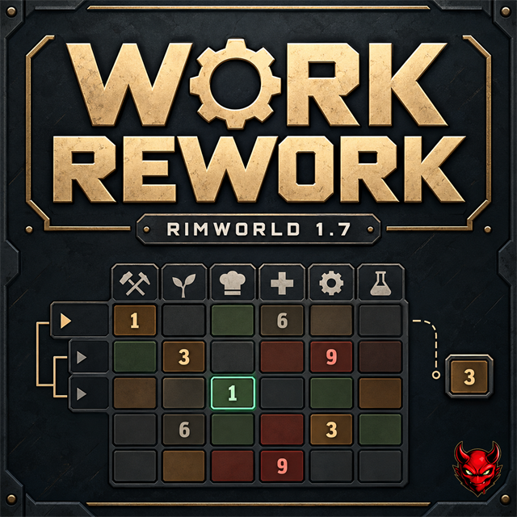

# Work Rework

**RimWorld 1.7 · Version 1.0.1 · Harmony required · English / Français**

Take control of the Work tab: expand vanilla categories, set individual subtask priorities, reorder work and turn a task into a standalone column.

[MIT license](LICENSE)

## Features

- Expand and collapse categories with **Ctrl + left-click** on their label.
- Choose a maximum priority between **1 and 9**; 1 comes first and 0 disables work.
- Assign per-pawn child priorities or inherit the category's last group value. A parent shows the lowest non-zero child value and **\*** when values differ.
- Reorder groups and children by dragging their handles or using Move up / Move down. Make a child standalone, or return it to its original category.
- Preserve each pawn's effective priority during organization changes. Use a draft with **Apply / Cancel**, plus **Restore vanilla organization**.
- Highlight the current work with a green frame on the visible task or collapsed parent.
- Save space with optional vertical labels and scroll only when visible content overflows.
- Set an initial priority for new colonists without changing existing assignments.
- Use optional **Grouped Pawns Lists** integration for group-row controls.

## Controls

**Left / right-click** cycles priorities. **Middle-click** opens a value menu. **Ctrl + right-click** on an attached child restores inheritance. **Organize work** opens the two-list editor from the Work tab or the mod settings.

Editing a parent applies its value to all attached children and clears their overrides. Disabling the parent blocks those children. A standalone task stays independent of its original category.

Numeric priority comes before layout order. For ordinary work selection, main order then child order break equal-priority ties; native emergency passes and forced orders retain their rules.

## Installation

Extract a built package into the game's `Mods` directory so the metadata is at `Mods/WorkRework/About/About.xml`. Enable **Harmony**, then **Work Rework**. Restart the game after updates.

The source checkout does not contain a prebuilt DLL. Build it or use the prepared ZIP; copying an unbuilt source checkout into Mods is insufficient.

**Do not combine with Work Tab.** Other work-management mods have not been individually validated.

For **Grouped Pawns Lists**, use **Harmony → RWLayout → Grouped Pawns Lists → Work Rework**. Grouped Pawns Lists and RWLayout remain optional. The integration was user-tested with Grouped Pawns Lists 2.3.2 on RimWorld 1.7. It supports parent, child and standalone group cells, the configured priority range, both work-priority modes, grouping and conditional scrolling.

## Settings and saves

Organization and per-pawn subtask overrides are saved with the game. Expanded/collapsed work categories are temporary display state. Vertical labels, maximum priority and initial priority are global mod preferences.

Changing the maximum requires **Apply priority settings**. A lower maximum reduces higher stored values to the new limit, including group bases and overrides; raising it later does not recover the old values. The limit is also applied when loading a game.

The default priority starts at 3 and is used for the tasks the game activates for starting colonists when preparing a new map, and on other new pawns' first work initialization. It does not activate every work category or change an already-initialized pawn in an existing save, including an existing world pawn being recruited. Reactivating a task keeps its existing cycling/checkbox behavior.

Adding the mod to an existing save and saving/reloading settings were user-tested. Removal and downgrades have not been validated. The initial test scope is adult human colonists; other populations have not received dedicated validation.

## Development and publication

The development checkout includes build instructions, validation records and Workshop preparation documents.

The complete feature set was accepted by the user through version 0.6.2. Version **1.0.0** is the first complete release, prepared from that baseline. Its Workshop item has been created and is currently private.

Version **1.0.1** fixes missing category and subtask names in the organization editor and Work tab tooltips, including labels supplied by mods or DLC. The fix was user-tested locally; the Workshop update is prepared for the creator to upload.

Source, scripts and documentation use the existing MIT license. Visual assets are separate: see [LICENSING.md](LICENSING.md). The cover is AI-generated promotional artwork, not an in-game screenshot. The creator-provided mod icon is preserved.

Inspired by the ideas of Work Tab and Complex Jobs. No binaries or decompiled source from those mods, the game, Harmony or RWLayout are included.
