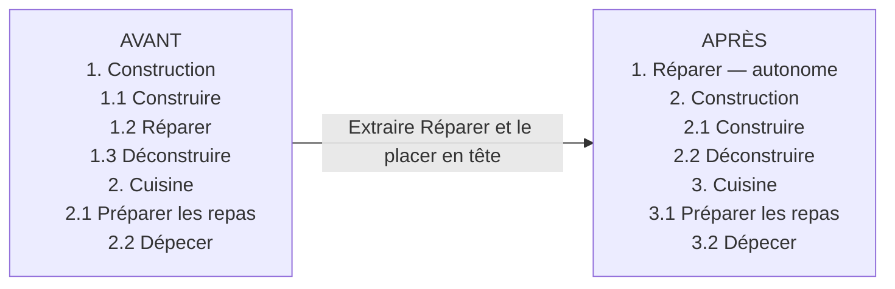

# Work rework — cadrage fonctionnel à discuter

Date : 23 octobre 2026. Cible : RimWorld 1.7.

Statut : étapes 1, 2 et 2b et leurs correctifs validés par l'utilisateur. Étape 3 implémentée dans 0.2.0, à valider en jeu. Décisions supplémentaires du 24 octobre 2026 : parent désactivé bloquant tous les enfants ; résumé du parent par minimum non nul + astérisque ; modifier le parent applique la valeur à tous les enfants et réinitialise leurs exceptions. Suivi : [PLAN-VALIDATION.md](PLAN-VALIDATION.md), [STATE.md](STATE.md) et [TESTING.md](TESTING.md).

## 1. Besoins exprimés

- Remplacer/enrichir l'onglet Travail avec un découpage plus fin, inspiré de Work Tab et Complex Jobs.
- Afficher en couleur la tâche actuellement effectuée par chaque colon.
- Étendre les priorités, par exemple de 1 à 9.
- Réordonner et regrouper les tâches en parents/enfants, depuis les options, avec glisser-déposer.
- Cadrer précisément le comportement avant de développer.

## 2. Orientations confirmées par l'utilisateur

1. « Le parent sert surtout à regrouper une liste de jobs et les enfants sont triés avec un sous-ordre. »
2. Le glisser-déposer change également l'ordre de sélection à priorité numérique égale.
3. Mod autonome, sur une base vanilla par défaut, que l'on étend ensuite selon ses besoins. Complex Jobs n'est pas une dépendance obligatoire.

4. Le chiffre 1–9 est porté par le parent par défaut, avec possibilité de définir un chiffre différent sur certains enfants, pour chaque colon.
5. Au premier lancement, afficher les colonnes vanilla ; leurs sous-tâches sont accessibles en dépliant chaque catégorie.
6. Une organisation commune à tous les colons ; seules leurs priorités diffèrent.
7. Deux niveaux maximum : groupe → tâches.
8. Un enfant peut devenir une entrée autonome au niveau des parents. Il ne peut pas être rattaché à un parent autre que sa catégorie vanilla d'origine. La création de groupes arbitraires recevant des tâches d'autres catégories est exclue.
9. Lors d'une modification de rattachement, conserver la priorité effective précédente de chaque colon, en la rendant explicite si nécessaire. Avec la règle 8, cette conservation concerne surtout l'extraction d'un enfant et son éventuel retour à sa catégorie d'origine ; le scénario Construction → Entretien n'est pas autorisé.
10. Le parent affiche le plus petit chiffre non nul de ses enfants et * s'ils n'ont pas tous la même valeur. Exemple : 4, 1, 0 donne 1*. Le zéro est exclu du minimum mais compte dans la détection des différences ; tous à zéro donne désactivé sans astérisque.
11. Attribuer une nouvelle valeur au parent est une commande de groupe : tous ses enfants prennent cette valeur et leurs exceptions sont réinitialisées. Cette décision remplace la proposition initiale de conserver les exceptions lors d'une modification du parent.
12. Un parent désactivé bloque tous ses enfants, y compris une exception éventuellement présente dans les données. Une commande de désactivation du parent réinitialise aussi ses exceptions comme toute commande de groupe.

Schéma avant/après fourni et validé. Suite demandée : avancer étape par étape avec checklist et validation utilisateur à chaque fois. Prévoir une phase 2 de compatibilité avec d'autres mods, notamment Grouped Pawns Lists (Workshop 2340773428).

## 3. Vocabulaire et organisation proposée

- Groupe : un parent nommé, par exemple « Construction ». Aucun travail n'est exécuté par un groupe lui-même.
- Tâche autonome : un ancien enfant extrait au niveau principal, par exemple « Réparer ». Il devient une colonne indépendante avec sa propre priorité par colon ; ce n'est pas un nouveau groupe libre pouvant accueillir des tâches d'autres catégories.
- Tâche : une feuille à laquelle le joueur attribue une priorité, par exemple « Réparer ». Elle rassemble un ou plusieurs WorkGiverDef existants.
- WorkGiverDef : fournisseur de tâches du jeu. Un même fournisseur peut proposer plusieurs recettes/actions ; il ne correspond donc pas nécessairement à une action détaillée unique.
- V1 : deux niveaux seulement, groupe → tâche. Pas de groupe imbriqué dans un autre groupe.
- Une tâche apparaît une seule fois dans l'organisation ; pas de duplication entre groupes.
- La catégorie vanilla d'origine est conservée comme référence stable même après extraction. Elle continue à déterminer les règles natives de compétence et d'incapacité.
- Le regroupement organise l'affichage et le sous-ordre et fournit la priorité héritée ; il ne change pas le WorkTypeDef d'origine, les compétences ou les incapacités d'un colon.

## 4. Priorités : règle proposée

- Valeurs : désactivé, puis 1 à 9. 1 est la plus forte priorité ; « désactivé » n'est jamais une priorité haute.
- Modèle confirmé : une valeur de référence est conservée par groupe et par colon pour l'héritage ; chaque enfant peut avoir une exception explicite. La cellule parent affiche le résumé des enfants, pas nécessairement cette valeur de référence.
- « Hériter » est un état distinct d'une valeur explicite, même si les deux donnent actuellement le même chiffre.
- Exemple : Construction = 4, Construire = hériter, Réparer = 1. Construire vaut 4 et Réparer vaut 1.
- Changer le parent applique la valeur choisie à tous les enfants et réinitialise leurs exceptions. Une commande distincte permet aussi de rétablir l'héritage à la dernière valeur de groupe, sans choisir un nouveau chiffre.
- Parent désactivé : tous les enfants sont bloqués et non modifiables avant réactivation du groupe. Cela ne peut jamais contourner une incapacité native.
- Exemple : dernière valeur de groupe 4, Réparer explicite 1, Déconstruire explicite 0, autres enfants hérités 4 : parent 1*. Choisir 3 sur le parent donne tous les enfants à 3, sans astérisque ni exception.
- Une incapacité native du colon reste prioritaire sur tout réglage : cellule grisée non modifiable, avec motif.

Règle confirmée indépendante de ce choix : le sous-ordre départage les tâches de même priorité. Il ne permet jamais à une priorité 6 de dépasser une priorité 2.

Proposition d'interaction sur les cellules numériques : clic gauche fait monter la priorité (désactivé → 9 → … → 1 → désactivé), clic droit fait l'inverse ; menu de cellule pour choisir directement une valeur ou rétablir l'héritage d'un enfant. Une action sur un enfant crée une exception ; un indicateur distingue priorité héritée et priorité explicite.

Implémentation 0.2.0 : clic milieu ouvre le menu, Ctrl + clic droit sur un enfant rétablit l'héritage, bordure bleue sur une valeur propre. En mode simple les cellules utilisent coche/vide, en mode manuel les chiffres 1–9 ; les valeurs sont conservées entre modes si aucune commande ne les remplace. Le copier/coller natif inclut base de groupe et exceptions.

## 5. Ordre de travail : règle proposée

Pour les travaux ordinaires que le jeu autorise à sélectionner :

1. Exclure les tâches désactivées ou impossibles pour le colon.
2. Essayer la priorité numérique la plus forte.
3. À priorité égale, suivre l'ordre des groupes puis des tâches à l'intérieur de chaque groupe.
4. À l'intérieur d'une tâche regroupant plusieurs fournisseurs, conserver leur ordre natif et leurs règles de sélection.
5. Si aucun travail n'est disponible, essayer la tâche suivante.

Exemple : Réparer = 2, Cuisiner = 2, Nettoyer = 6. Si Réparer précède Cuisiner, le colon essaie Réparer d'abord ; faute de réparation possible, il essaie Cuisiner, puis Nettoyer. Déplacer Nettoyer devant Réparer ne lui permet pas de dépasser une priorité 2.

L'ordre principal contient à la fois les catégories vanilla et les tâches devenues autonomes. À priorité égale, une catégorie est parcourue selon le sous-ordre de ses enfants restants. Une tâche extraite n'est plus essayée à son ancienne position dans sa catégorie. Tous les colons utilisent cet ordre commun, avec leurs propres priorités effectives.

Le tri s'applique au travail ordinaire. Besoins, mobilisation, ordres manuels, urgences et obligations imposées par le jeu conservent leur traitement. Modifier un réglage ne doit pas interrompre immédiatement un travail en cours ; le nouvel ordre s'applique à la prochaine sélection normale.

Limite à vérifier au prototype : certains fournisseurs sont comparés ensemble par les scanners du jeu. Un simple tri de liste ne suffit pas à garantir ces règles ; les frontières de comparaison et le circuit des urgences doivent être vérifiés dans le code 1.7.

## 6. Base vanilla et extensions facultatives

Au premier lancement, conserver les catégories vanilla et l'ordre natif, avec des colonnes parents repliées. Leurs sous-tâches vanilla sont disponibles dès le départ en dépliant les catégories, sans configuration préalable. Tous les enfants héritent initialement du parent. Ne pas imposer le découpage de Complex Jobs ni des regroupements sémantiques supplémentaires. Les priorités existantes sont conservées.

Les quatre exemples suivants sont un catalogue de libellés et de fournisseurs relevés dans les Defs locales 1.7. Certains réunissent plusieurs fournisseurs : ils ne constituent pas une nouvelle organisation activée par défaut ni une autorisation de créer des groupes arbitraires. Proposition pour la base initiale : un enfant par fournisseur vanilla, dans son ordre natif. La fusion de plusieurs fournisseurs en une feuille n'est pas décidée pour la V1.

### Construction

- Réparer : Repair.
- Réparer les pannes : FixBrokenDownBuilding.
- Construire : ConstructFinishFrames.
- Livrer les matériaux : ConstructDeliverResourcesToFrames, ConstructDeliverResourcesToBlueprints.
- Déconstruire : Deconstruct, ConstructRemoveFloors, ConstructRemoveFoundations.
- Désinstaller : Uninstall.
- Poser les toits : BuildRoofs.
- Retirer les toits : RemoveRoofs.
- Lisser : ConstructSmoothFloors, ConstructSmoothWalls.
- Préparer le chantier : DeconstructForBlueprint, FillIn. Intitulé et regroupement à vérifier en jeu avant validation ; la déconstruction nécessaire à un plan doit rester distincte de la déconstruction libre.

### Cultures

- Récolter : GrowerHarvest.
- Semer : GrowerSow, PlantSeed.
- Replanter : Replant.

### Cuisine

- Préparer les repas : DoBillsCook, DoBillsCookCampfire.
- Dépecer : DoBillsButcherFlesh.
- Brasser : DoBillsBrew.

### Extraction

- Miner : Mine.
- Forer : Drill.

Les autres catégories restent accessibles dans leur organisation d'origine, avec leurs fournisseurs. Chaque fournisseur non affecté à une feuille conserve une place dans une feuille de repli de sa catégorie d'origine : aucune tâche ne doit disparaître silencieusement.

Ce découpage ne permet pas de séparer automatiquement deux recettes servies par le même fournisseur, par exemple deux types de repas. Cette demande éventuelle constituerait une fonctionnalité distincte.

## 7. Onglet Travail

- Lignes : colons ; colonnes : groupes et leurs enfants dépliés.
- Ctrl + clic gauche sur le libellé d'un groupe ouvre/ferme ses enfants sans modifier les priorités ni trier les colons. Aucun bouton +/− dédié. Ce geste est limité aux libellés des catégories ; les autres clics et futures cellules de modification de colonne gardent leurs actions propres.
- Replier un groupe ne désactive jamais ses tâches.
- Les enfants suivent le mode de l'onglet Travail : affichage oui/non en mode simple, chiffres en mode priorités manuelles. Depuis l'étape 3, ils sont modifiables avec héritage ou exception, dans les deux orientations de libellés.
- La cellule du travail en cours reçoit un fond/surlignage ; les chiffres restent lisibles.
- Si le groupe est replié, sa cellule porte l'indicateur du travail en cours.
- Si la tâche a été extraite, seule sa colonne autonome porte l'indicateur ; son ancien parent n'est pas surligné pour cette tâche.
- La tâche active est identifiée via le fournisseur du travail courant, pas par une comparaison de libellés.
- Si le travail courant n'a pas de fournisseur identifiable (repos, déplacement particulier, tâche imposée), aucune cellule de travail n'est marquée arbitrairement.
- Afficher une infobulle avec tâche courante, priorité effective et origine de la valeur (parent ou exception de l'enfant).
- Une modification de priorité ne signifie pas que le colon va immédiatement interrompre son action actuelle.
- Amélioration demandée après les tests de l'étape 2 : option pour basculer les noms de jobs à la verticale afin de réduire la largeur des colonnes. Jalon 2b implémenté en 0.1.1 : réglage global horizontal par défaut, texte tourné de 90° en mode vertical, appliqué aux catégories et sous-tâches. Largeur 32 px, hauteur mesurée 110–260 px ; infobulles complètes et Ctrl + clic adapté à la zone tournée. Retour utilisateur : tests OK ; correction demandée et implémentée en 0.1.2 pour aligner tous les libellés sur le bas de l'en-tête, plutôt qu'au centre, en conservant une marge de tri. Les futures tâches autonomes devront adopter ce même réglage.

## 8. Options et glisser-déposer

- Écran « Organisation du travail » : groupes repliables et tâches indentées.
- Poignée de déplacement distincte du nom ; déplacer un groupe emporte ses enfants.
- Déplacer un enfant dans sa catégorie vanilla change son sous-ordre.
- Déposer un enfant sur une ligne d'insertion du niveau principal l'extrait et crée une entrée autonome, à la position choisie.
- Une entrée autonome peut ensuite être réordonnée parmi les catégories vanilla.
- Déposer une tâche dans une catégorie différente de sa catégorie d'origine est interdit ; aucune zone de dépôt valide n'y est proposée.
- Retour autorisé d'une entrée autonome vers sa seule catégorie d'origine, par dépôt dans cette catégorie ou commande « Réintégrer la catégorie d'origine », conformément au schéma validé.
- Interdire les cycles et les doublons ; profondeur maximale de deux niveaux.
- Ne pas proposer la création de groupes arbitraires ni la suppression de tâches du catalogue. Extraire une tâche la déplace sans la dupliquer.
- Édition sous forme de brouillon, boutons « Appliquer » et « Annuler ».
- À l'extraction, conserver pour chaque colon la priorité effective de l'enfant, y compris désactivé. La nouvelle colonne possède désormais cette valeur explicite et ne suit plus les changements de son ancien parent.
- À la réintégration, conserver ces valeurs comme exceptions explicites, même si elles égalent momentanément celles du parent. Le joueur peut ensuite rétablir l'héritage volontairement.
- Exemple à deux colons : Réparer hérite de Construction = 4 pour Alice et = 2 pour Bruno. Après extraction, Réparer vaut explicitement 4 pour Alice et 2 pour Bruno. Passer Construction à 6 pour Alice ne modifie plus son Réparer = 4.
- Proposer aussi des commandes « Monter », « Descendre », « Rendre autonome » et « Réintégrer » pour effectuer les mêmes opérations sans glisser-déposer.
- Option « Restaurer l'organisation d'origine » distincte de « Réinitialiser les priorités » : restaurer l'affichage ne doit pas effacer les affectations des colons.
- L'ordre est commun à tous les colons. Proposition de stockage : organisation et priorités propres à la partie ; options globales pour les préférences visuelles. Export/import de profils reporté après la V1.

## 9. Données, installation et compatibilité

- À l'ajout sur une partie : reprendre les priorités existantes 0–4 sur les parents, sans conversion automatique vers une autre échelle ; les enfants héritent initialement de leur parent. Une priorité existante à 1 reste à 1.
- Sauvegarder les priorités par colon, les identifiants stables des groupes, les références aux Defs et les sous-ordres ; ne pas utiliser les libellés traduits comme clés.
- Retirer un mod fournissant une tâche : conserver sa configuration inactive sans erreur ; réactiver seulement si la Def revient.
- Ajouter un mod : intégrer ses nouveaux fournisseurs dans leur catégorie d'origine, sans écraser l'organisation personnalisée.
- Prévoir un retour aux priorités natives : conversion explicite des valeurs 5–9 vers 4 et traitement des éventuelles priorités détaillées selon le modèle retenu. Le comportement au retrait complet doit être éprouvé sur copie de sauvegarde avant d'être annoncé comme sûr.
- Work Tab : considérer le chargement simultané comme non pris en charge au départ, car les deux mods piloteraient le même onglet et les mêmes priorités.
- Complex Jobs : si optionnel, lire les Defs après ses modifications et éviter de recréer en doublon les mêmes tâches. Ne pas annoncer cette compatibilité avant un test réel.
- Phase 2 : Grouped Pawns Lists (Workshop 2340773428) est une cible de compatibilité explicite. L'utilisateur confirme son fonctionnement en 1.7 malgré l'absence de tag ; ce fonctionnement n'a pas encore été testé ici. Ce mod regroupe les lignes de colons, tandis que notre organisation concerne les colonnes de travail. Prévoir leur coexistence et la vérification des actions sur les en-têtes de groupes de colons.
- Première validation sur colons humains ; esclaves, enfants et méchanoïdes demandent une matrice dédiée avant toute promesse de support.
- Aucun code ou visuel de référence n'a été copié. Si du code Work Tab est repris, conserver les mentions MIT ; sa licence distingue le logiciel des contenus originaux sous CC BY-SA.

## 10. Constats techniques vérifiés et limites

Vérifications locales du 23 octobre 2026 :

- Version.txt indique 1.7.4985 rev1269.
- L'installation a Assembly-CSharp.dll à la racine et une configuration d'exécution net10.0 ; le chemin historique RimWorldWin64_Data/Managed n'existe pas ici. Le projet 1.6/net472 du starter ne doit donc pas être recopié sans adaptation.
- Lecture des métadonnées de l'assembly, sans exécuter le jeu : présence de Pawn_WorkSettings (SetPriority, GetPriority, CacheWorkGiversInOrder), JobGiver_Work, PawnColumnWorker_WorkPriority et MainTabWindow_Work.
- Job contient workGiverDef ; WorkGiverDef contient workType, priorityInType et emergency.
- ReorderableWidget expose notamment NewGroup, NewMultiGroup et Reorderable : candidat pour le glisser-déposer. Signatures et usage à inspecter avant implémentation.
- Les identifiants du découpage ci-dessus ont été relevés dans Data/Core/Defs/WorkGiverDefs/WorkGivers.xml de cette installation.
- Les métadonnées ne prouvent ni les signatures complètes utilisables ni le comportement interne. L'extension 1–9 doit vérifier validation, interface, sérialisation, caches et sélection réelle ; remplacer uniquement l'affichage du chiffre ne suffit pas.
- Étape 1 : Harmony Workshop annonce 3.0.1.0 ; son assembly 1.7 porte la version 3.0.0.0 et cible .NET 10, comme le jeu. Les signatures du constructeur Harmony et du point d'entrée Verse.Mod ont été vérifiées et la compilation réussit. La compatibilité à l'exécution reste à valider en jeu.

## 11. Critères d'acceptation du premier prototype

1. Sur une copie de partie, ajouter le mod préserve les affectations 0–4 de chaque colon.
2. Au premier lancement, les catégories et l'ordre vanilla sont conservés ; aucun découpage supplémentaire n'est imposé.
3. Réparer et Construire, à priorité applicable égale, suivent leur sous-ordre natif à l'étape 3, puis configuré à l'étape 4. Valeur de groupe 4 et Réparer 1 donnent Construire 4 et Réparer 1 après sauvegarde/rechargement ; le parent résume 1*. Attribuer 6 au parent donne tous les enfants à 6 sans exception.
4. Deux tâches disponibles à priorité 2 suivent leur ordre configuré ; une tâche à 6 déplacée en premier ne les dépasse pas.
5. Replier un groupe ne change aucune affectation ; le surlignage du travail en cours remonte au parent.
6. Extraire Réparer de Construction crée une seule colonne autonome et préserve sa priorité effective pour chaque colon ; Annuler ne modifie pas la partie. Le dépôt dans Cuisine est refusé. Si la réintégration proposée est retenue, seul Construction accepte le retour et les valeurs sont conservées en exceptions.
7. Un colon incapable de construire ne peut pas être rendu capable par regroupement avec une tâche autorisée.
8. Un fournisseur ajouté par un autre mod reste accessible ; aucun fournisseur existant n'est perdu lors du découpage.
9. Les urgences et les ordres manuels suivent encore les règles natives dans des scénarios dédiés.
10. Sauvegarder/recharger restaure ordre, groupes et priorités sans modifier leurs identifiants.

Ce sont des tests à effectuer, pas des validations déjà obtenues.

## 12. Schéma de réorganisation validé

Exemple simplifié : seules quelques sous-tâches sont représentées, et leur ordre de départ est illustratif.

Les numéros de position de ce schéma représentent l'ordre commun de parcours, jamais les chiffres de priorité des colons.

Gestes proposés :

1. Saisir la poignée d'une catégorie pour déplacer cette catégorie avec tous ses enfants restants.
2. Déplacer la poignée d'un enfant à l'intérieur de sa catégorie pour modifier son sous-ordre.
3. Déposer un enfant entre deux entrées principales pour le rendre autonome à cet emplacement.
4. Interdire tout dépôt de cet enfant sous une autre catégorie vanilla. Afficher le refus avant relâchement.
5. Retour autorisé uniquement vers la catégorie d'origine. Les valeurs autonomes deviennent des exceptions explicites ; rétablir l'héritage reste une action volontaire.

Une ligne d'insertion pleine largeur indique une position principale ; une ligne indentée indique une position à l'intérieur de la catégorie d'origine. Les mêmes opérations disposent de commandes textuelles pour éviter de dépendre exclusivement du geste de glisser-déposer.

Exemple de priorités conservées : Alice a Construction = 4 et Réparer hérité = 4 ; Bruno a Construction = 2 et Réparer explicitement = 1. Après extraction, la colonne Réparer vaut 4 pour Alice et 1 pour Bruno. Une modification ultérieure de Construction ne change plus ces valeurs.

Exemple de sélection ordinaire avec l'ordre APRÈS : pour Alice, Réparer = 4, Construction = 4, Cuisine = 2. Essayer les travaux de Cuisine d'abord, puis Réparer, puis les enfants restants de Construction. Si toutes ces valeurs passent à 4, suivre Réparer, puis Construire, Déconstruire et les enfants de Cuisine dans leur sous-ordre. Chaque tentative passe à la suivante si aucun travail exécutable n'est disponible.

Validation du schéma : « Oui ça me semble correct », le 23 octobre 2026. La réintégration vers l'origine avec conservation des valeurs reste retenue pour l'étape 4. Les décisions de priorité prises ensuite le 24 octobre (parent bloquant, résumé et commande de groupe) sont détaillées dans les sections 2 et 4 ; elles remplacent les propositions antérieures contradictoires.

Implémentation de l'étape 4 (0.3.0, à valider en jeu) : organisation enregistrée par partie, sous la clé workOrganization. Deux listes affichent les colonnes principales et les enfants du groupe sélectionné. Le glisser-déposer avec ligne d'insertion native est limité à chaque liste ; Rendre autonome / Réintégrer sont des boutons explicites. L'extraction place la tâche après son origine, puis elle peut être déplacée à la position voulue. Cette variante d'interaction remplace les dépôts entre niveaux proposés ci-dessus ; aucun dépôt vers une autre origine n'est accepté.

Le brouillon ne modifie pas la partie avant Appliquer. Les valeurs individuelles sont conservées, y compris zéro et les chiffres masqués par le mode simple. À la réintégration dans un groupe éteint, une tâche active réactive la base nécessaire ; les autres enfants de ce groupe sont figés à zéro pour préserver leur état effectif. Une tâche autonome ne participe plus au résumé ni aux commandes de son ancien groupe. La priorité numérique reste supérieure à l'ordre choisi ; le circuit d'urgence natif reste séparé.

## Sources de référence

- Work Tab (Continued) : https://steamcommunity.com/sharedfiles/filedetails/?id=3453549086 — annonce 1.5/1.6 ; surlignage de la tâche courante et sous-colonnes.
- Sources Work Tab : https://github.com/JiaRG/WorkTab — source de référence à inspecter avant toute réutilisation.
- Complex Jobs : https://steamcommunity.com/sharedfiles/filedetails/?id=2069684319 — annonce 1.7 ; découpage des catégories.
- Liste des tâches Complex Jobs : https://steamcommunity.com/workshop/filedetails/discussion/2069684319/4289187886487779709/.
- Grouped Pawns Lists : https://steamcommunity.com/sharedfiles/filedetails/?id=2340773428 — regroupement des listes de colons ; dépendances annoncées Harmony et RWLayout ; sources https://gitlab.com/krypt_lynx/PawnTableGrouped/. Fonctionnement en 1.7 signalé par l'utilisateur, à tester avec notre mod en phase 2.
- Copies locales installées : About.xml et LICENSE de Work Tab ; About.xml et dossier 1.7 de Complex Jobs.
